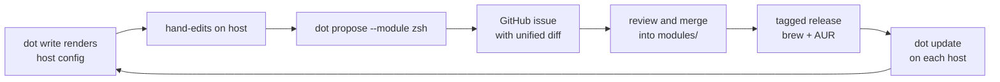

# Plan: dot — modular, versioned dotfile manager

## 1. Problem analysis

`geoffjay/cfg` distributes dotfiles as a bare git repository checked out
into `$HOME`:

```sh
git clone --bare https://github.com/geoffjay/cfg.git $HOME/.cfg
alias config="git --git-dir=$HOME/.cfg --work-tree=$HOME"
```

Three structural failures follow from git being the *distribution
mechanism*:

1. **No user preferences, no opt-out.** Content is verbatim; every host
   receives every file. Disabling a tool's config means deleting the file
   locally and fighting git about it forever. Per-user values (name,
   email, theme) are baked into the distributed files.
2. **Host-OS logic duplicated inside every file.** Platform and tool
   differences are hand-coded guards inside the files themselves —
   `.bash.d/10-alias` binds `ls` to coreutils `gls` unconditionally and
   wraps tool availability in `if [[ -x $(which bat) ]]`. Nothing is
   centralized, testable, or shareable between files.
3. **Distribution = drift.** Updating is a manual `git pull` into a work
   tree (i.e. `$HOME`) that is expected to be dirty; hosts diverge, and
   there is no mechanism to carry a local improvement back upstream
   except hand-crafted patches.

**Root cause:** git is doing both versioning *and* distribution. The fix
is a compiled binary whose managed content is versioned with the tool
itself (embedded modules), a config layer for per-user/per-host
selection, host facts injected at render time, and an explicit upstream
path for local changes (`dot propose`).

## 2. Solution model

Four inputs produce rendered files:

1. **Module** (embedded in the binary at build time): metadata +
   templates for one tool (zsh, git, tmux, …).
2. **User config** (TOML): which modules are enabled, user preferences,
   per-host overrides.
3. **Host facts** (detected at write time): os, distro, arch, hostname,
   username, package managers, available tools.
4. **dot version**: embedded templates always match the installed
   binary — content and tool ship together, so there is no drift
   between "what dot thinks" and "what dot is".

Core invariants:

* The binary is the source of truth for content; config + facts are the
  source of truth for selection and substitution.
* Every dot-written file is recorded in a manifest; files dot does not
  own are never touched.
* Nothing is written without an available preview (`dot diff`) and an
  automatic backup path.

The feedback loop that replaces "hosts drift silently":



## 3. Commands

All content-producing commands accept `--module <name>` (repeatable) to
scope to specific modules; without it they act on all enabled modules.

### `dot init`

* Interactive wizard (dialoguer): user values (name, email, theme),
  multi-select of available modules, config path confirmation.
* Writes the config file (§4). Re-running merges: existing keys are
  offered as defaults, unknown keys are preserved, nothing is clobbered.
* Detects a legacy `~/.dotrc` and offers to migrate it.
* `--non-interactive` + `--answers <file>` accept a TOML answer sheet so
  the wizard is scriptable and CI-testable. `--force` allows overwrite.

### `dot write`

* Renders every enabled module with config + facts into a write plan,
  then executes it: creates parent dirs, writes files, records each in
  the manifest (path, module, template, sha256, dot version, timestamp).
* Unchanged files (hash match with manifest) are skipped; `--force`
  rewrites anyway.
* First management of a pre-existing unmanaged file: the original is
  copied to the backup area before overwrite (§7).
* Refuses to manage a file already owned by another module in the
  manifest.
* Prints per-file actions and a created/updated/unchanged summary.

### `dot diff`

* The canonical preview of `dot write`: renders the same plan and prints
  a unified diff of plan vs. on-disk state (new files shown as additions).
* Exit codes follow diff(1): `0` identical, `1` differences, `2` error.
  This makes `dot diff` usable in scripts and prompts.

### `dot backup`

* Explicit snapshot of all dot-managed files plus the config and
  manifest into `~/.config/state/dot/backups/<YYYYmmdd-HHMMSS>/`
  (§7). Prints what was captured.
* Prunes old snapshots, keeping the most recent 10 (configurable).

### `dot restore`

* Restores dot-managed files from a backup: `--backup <id>` selects one,
  default `latest`.
* Refuses to overwrite a file that changed on disk after the backup
  unless `--force` is given; `--list` shows available backups.

### `dot update`

* Detects how dot was installed:
  * macOS / Homebrew: `brew list --versions dot` → `brew upgrade dot`.
  * Arch / AUR: pacman owns `dot-bin` → run the user's AUR helper
    (`yay`/`paru`) to upgrade (`yay`/`paru -S dot-bin`, or full `-Syu`).
  * Otherwise: print manual instructions (GitHub release tarball +
    checksum verification) — no silent self-replacement in v0.1.
* `--check` only reports current version vs. latest published release
  (GitHub releases API) without installing. Priority per requirement:
  brew, then AUR, then fallback.

### `dot propose`

* `--module zsh` (repeatable; without it, all modules with drift):
  for each managed file of the module, diff **on-disk content** (the
  locally edited version) against **what the current binary + config
  would render**, producing the unified diff of local changes that
  upstream does not have yet.
* Opens a GitHub issue on `geoffjay/dot` via the `gh` CLI (reuses
  existing auth from the gh module; falls back to the REST API with
  `GITHUB_TOKEN`). Issue body: host facts table (os, distro, arch,
  hostname, dot version), the effective `[modules.<name>]` config block
  with values of keys matching `token|password|secret|key` redacted, and
  the diffs in fenced blocks. Label `proposal`.
* Files marked `sensitive` in module metadata are **never** included in
  propose output (the cfg repo ships `.config/gh/hosts.yml`, which
  contains OAuth tokens — this is the main leak risk).
* `--dry-run` prints the issue body without creating anything (also the
  test path).

## 4. Configuration file

Canonical path: `~/.config/dot/config.toml` (XDG `dot` project dir).
`~/.dotrc` is read as a legacy fallback when the canonical file is
absent. `--config <path>` / `$DOT_CONFIG` override both.

```toml
version = 1

[user]                     # user-specific preferences, templated as {{ user.* }}
name = "Geoff Johnson"
email = "geoff@example.com"
theme = "nord"

[modules.git]              # opt-out = enabled = false
enabled = true

[modules.zsh]              # module prefs (defaults come from module.toml)
enabled = true
plugins = ["autosuggestions", "syntax-highlighting"]
prompt = "starship"

[modules.tmux]
enabled = false

[hosts.worktop.modules.zsh]   # per-host overrides, keyed by hostname
plugins = ["autosuggestions"]
```

Precedence (low → high): module defaults (`module.toml [defaults]`) →
`[modules.<m>]` → `[hosts.<hostname>.modules.<m>]` → CLI `--set
<key>=<value>` one-off overrides. Merge is deep for tables and arrays.
Config errors are reported with file + line context (serde_path_to_error
or equivalent) — a broken TOML must not produce a mystery failure.

## 5. Module format

Modules live in the repo under `modules/<name>/` and are **embedded into
the binary at build time** (`include_dir`), so content and tool version
are inseparable:

```
modules/zsh/
  module.toml
  templates/zshrc.tmpl
  templates/zprofile.tmpl
```

```toml
# modules/zsh/module.toml
name = "zsh"
description = "zsh shell: rc, plugins, prompt"
os = ["macos", "linux"]        # module skipped on other platforms

[defaults]
plugins = ["autosuggestions", "syntax-highlighting"]
prompt = "starship"

[files]                        # template -> target, ~ expanded, HOME only
"zshrc.tmpl"    = "~/.zshrc"
"zprofile.tmpl" = "~/.zprofile"

[files.linux]                   # per-OS additions/overrides of [files]
"zshenv.tmpl" = "~/.zshenv"

sensitive = []                  # targets never emitted by propose
```

A `files` value may be a table `{ path = "...", mode = 0o755 }` for
scripts needing exec bits. Escape hatch: `~/.config/dot/modules/<name>/`
overlays built-in templates at render time (dot warns when an overlay is
active). The overlay is the pressure valve for "the binary doesn't do
what I need yet" without reopening the drift problem; overlays are the
natural input to a `propose`.

## 6. Rendering

* Engine: **minijinja** (Jinja2 syntax, custom filters/functions,
  autoescape off — this is shell config, not HTML). Alternative kept in
  mind: Tera; a swap would be localized to the render module.
* Context injected into every template:

```jinja
{# available: user.*, host.*, module name, dot version #}

eval "$(/opt/homebrew/bin/brew shellenv)"

# arch linux specifics

              {# custom fn: PATH lookup at write time #}
alias cat="bat --theme {{ user.theme }}"

```

* `host` = `{ os, distro, arch, hostname, username, package_managers }`
  (os_info + /etc/os-release, std::env::consts, gethostname, which).
* Custom function `has("<tool>")` replaces every hand-written
  `if [[ -x $(which ...) ]]` guard from cfg.
* Render failures are per-file with template name + line; `dot write`
  aborts before touching the filesystem if any template fails to render.

## 7. State, manifest, backups

State root (the user-specified `~/.config/state/dot`):
Linux: `${XDG_STATE_HOME:-~/.local/state}/dot`; macOS:
`$XDG_STATE_HOME` if set else `~/.config/state/dot` (no standard macOS
state location; `directories::state_dir()` returns None there, so dot
defines its own fallback).

```
<state>/
  manifest.toml             # managed files: path, module, template,
                           #   sha256 at last write, dot version, timestamp
  backups/
    20261018-101010/       # full snapshots (dot backup)
      files/...            #   content at backup time
      config.toml
      manifest.toml
    pre-write/             # originals of unmanaged files dot overwrote
```

The manifest is what makes diff/backup/restore/propose trustworthy:
"managed" is an explicit, inspectable list, not an inference.

## 8. Distribution and update (borrowed from tower)

The tower project (`~/Projects/tower`, v0.4.0) already solved Rust binary
distribution end-to-end; dot copies its machinery nearly verbatim:

| Borrow from tower | Purpose |
|---|---|
| `scripts/release.sh` + `Makefile.toml` | bump → gates → git-cliff changelog → PR → tag flow (`cargo make release -- --version X.Y.Z`) |
| `cliff.toml` | conventional-commit changelog |
| `.github/workflows/ci.yml` | lint/test gate (fmt, clippy -D warnings, test) |
| `.github/workflows/release.yml` | tag → CI → 4-target build matrix → GitHub release + `checksums.txt` → Homebrew tap → AUR |
| `scripts/gen-homebrew-formula.sh` + `packaging/homebrew/*.rb.tpl` | formula rendered from release checksums into `geoffjay/homebrew-tap` |
| `scripts/gen-aur-pkgbuild.sh` + `packaging/aur/PKGBUILD.tpl` | PKGBUILD + `.SRCINFO` pushed to AUR via `AUR_KEY` |
| workspace layout + lints (`unsafe_code = forbid`, release `lto`/`strip`) | repo conventions |

Parameters for dot: repo `geoffjay/dot`, binary name `dot`, targets
`aarch64-apple-darwin`, `x86_64-apple-darwin`, `x86_64-unknown-linux-gnu`,
`aarch64-unknown-linux-gnu`. Formula `geoffjay/tap/dot`; AUR package
`dot-bin` (verify availability, fallback `gdot-bin` — see risks).
Secrets: `HOMEBREW_TAP_TOKEN`, `AUR_KEY`. `dot update` (§3) consumes
these channels; the release notes body carries the install commands.

## 9. Workspace and stack

Two crates, mirroring tower's core/binary split without its server
complexity:

```
geoffjay/dot
  Cargo.toml               # workspace: version, lints, release profile
  crates/dot-core/         # lib: config, facts, modules, render, plan,
                          #      diff, state, backup, propose, update
  crates/dot/              # bin: clap command surface, wizard, output
  modules/                 # embedded content (§5)
  scripts/ packaging/ .github/  # tower-derived (§8)
```

| Concern | Crate | Rationale |
|---|---|---|
| CLI | clap 4, derive + env | tower convention |
| Errors | anyhow (bin) + thiserror (core) | tower convention |
| Config | serde + toml | typed config, line-context errors |
| Templates | minijinja | §6 |
| Diffs | similar | unified diffs, used by cargo |
| XDG paths | directories | §7 state/config resolution |
| Prompts | dialoguer | init wizard, scriptable |
| Embedding | include_dir | modules in binary |
| Facts | os_info, gethostname, which | §6 |
| HTTP | reqwest (rustls) | update `--check`, propose API fallback |
| Logging | tracing + tracing-subscriber | tower convention |
| dev | tempfile, assert_cmd | temp-HOME integration tests |

## 10. Testing

* **dot-core unit**: config merge/precedence (defaults → module → host →
  CLI), facts against fixture environments, per-module render golden
  assertions, plan/diff over tempdir trees, manifest roundtrip, backup
  prune policy.
* **CLI integration** (assert_cmd, `HOME` pointed at a tempdir):
  `init --non-interactive --answers …` → `write` → `diff` exits 0 →
  mutate a managed file → `diff` exits 1 → `backup` → `restore` →
  `diff` exits 0 → `propose --dry-run` emits expected diff. No network
  in tests; `update --check` and issue creation are behind injected
  endpoints/flags.
* **e2e**: `scripts/e2e.sh` (tower pattern) running the sequence above
  against a real binary in CI.

## 11. Milestones

Status as of the initial implementation (2026-10-18): **M0–M5 complete**,
M6 code complete (modules migrated and verified on a temp HOME); what
remains of M6 is publishing the v0.1.0 release (needs `HOMEBREW_TAP_TOKEN`/
`AUR_KEY` secrets and the AUR `dot-bin` availability check, see open
questions) and provisioning a real host.

| # | Milestone | Done when | Status |
|---|---|---|---|
| M0 | Scaffold + CI | workspace builds, `cargo make lint/test` gates green, packaging + release workflows copied and adapted, `dot --version` runs in CI | done |
| M1 | Core domain (dot-core) | config/facts/modules/render/plan/state unit-tested in isolation | done |
| M2 | `init`, `write`, `diff` | CLI integration sequence init→write→diff passes | done |
| M3 | `backup`, `restore` | round-trip test passes on temp HOME | done |
| M4 | `update` | brew/AUR detection + `--check` against releases API | done |
| M5 | `propose` | `--dry-run` payload correct (redaction + sensitive exclusion verified) | done |
| M6 | Module migration + v0.1.0 | modules migrated from cfg; release published to tap + AUR; first real host provisioned | code done; release pending |

## 12. Decisions (to be promoted to `decisions/` as implementation confirms)

* **D1 — embed modules in the binary** (vs. fetching from a repo at
  runtime). Content and tool version are inseparable → kills drift;
  `propose` is the upstream path; overlay dir is the escape hatch.
* **D2 — minijinja** for templates (Jinja2 syntax; custom `has()`
  function). Tera is the fallback, localized to one module.
* **D3 — HOME-only targets, no sudo.** dot writes under `$HOME`
  exclusively; system files stay with the OS package manager.
* **D4 — manifest + XDG state dir** as the definition of "managed";
  sensitive files never leave the host via propose.
* **D5 — canonical config `~/.config/dot/config.toml`**, `~/.dotrc` as
  legacy fallback (user's stated paths, both honored).
* **D6 — propose shells out to `gh` first** (auth already configured on
  these hosts), REST API fallback.
* **D7 — `dot update` drives the native package manager** (brew/AUR
  priority); no binary self-replacement in v0.1.
* **D8 — diff(1) exit codes** for `dot diff` (0/1/2) to make it
  scriptable.

## 13. Risks

* **R1 — binary name `dot` collides with graphviz's `dot`** on PATH when
  graphviz is installed. Accepted (user's chosen name); document in
  README; `dot` commands are unambiguous when typed.
* **R2 — AUR `dot-bin` is taken** by an abandoned Dot Browser package
  (last updated 2021, `provides=dot`). Resolved 2026-10-19: publishing as
  **`gdot-bin`** (the planned fallback, confirmed free); the binary still
  installs as `/usr/bin/dot` and `provides=(dot)`.
* **R3 — token leak via propose** (cfg ships `.config/gh/hosts.yml`).
  Mitigated by the `sensitive` flag (hard exclusion) + key redaction in
  config blocks.
* **R4 — macOS has no standard state dir.** dot's documented fallback
  `~/.config/state/dot` matches the user requirement; behavior is
  explicit in docs.
* **R5 — template runtime errors on exotic hosts.** Render is
  all-or-nothing per write (fail before touching FS) with per-file error
  context.
* **R6 — migration from the live bare repo.** First host switches by
  backing up cfg checkout (`dot backup` of nothing yet — manual copy),
  running `dot init` + `dot write`, comparing trees, then decommissioning
  the `config` alias. Documented as a runbook in M6.

## 14. Open questions to confirm before implementation

1. ~~AUR package name: is `dot-bin` free?~~ No — taken by an abandoned
   Dot Browser package (2021). Resolved: `gdot-bin` (see R2).

2. Accept graphviz PATH collision (R1) or prefer an alias/wrapper?
3. macOS state path confirmation: `~/.config/state/dot` as specced?
4. Is the `~/.dotrc` legacy path needed, or is XDG-only acceptable?